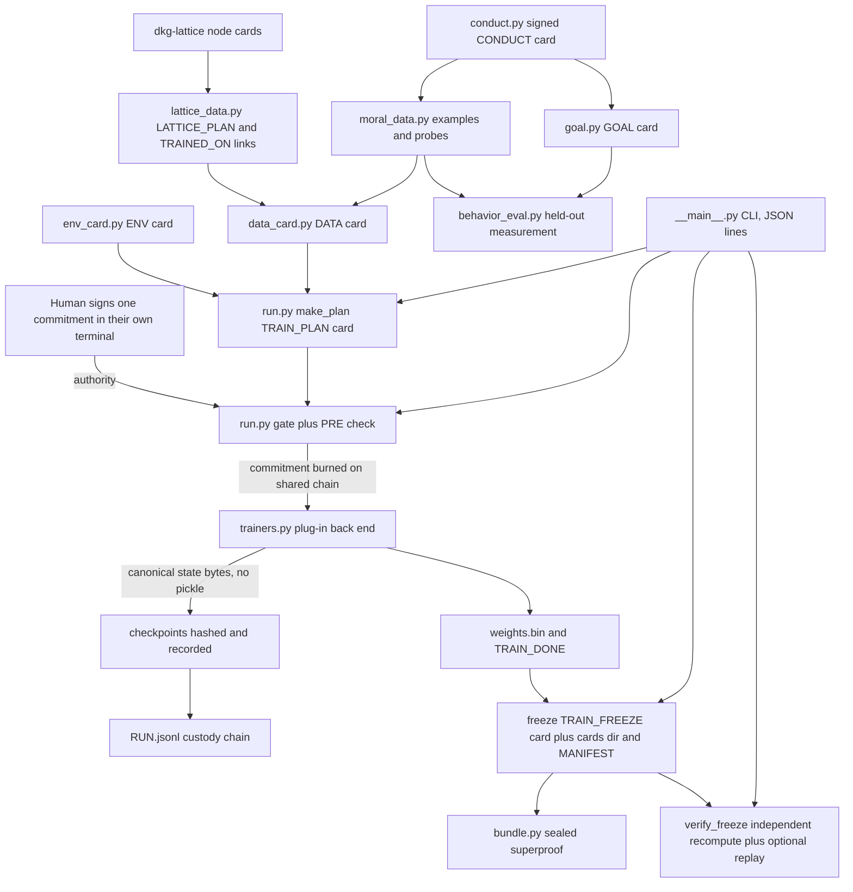

# vega-train-sdk — Architecture

## 1. The organism

This kit is layer 8 ("learn") of the 16-layer Vega SDK family. One family, one organism: every SDK owns exactly one concern and uses the owner of every other concern instead of growing its own copy.

```
                 ┌──────────────────────────┐
                 │   THE HUMAN (the owner)  │  holds the only signing key;
                 │  authority starts here   │  spends it one action at a time
                 └────────────┬─────────────┘
                              v single-use signed commitments
 15 assemble   vega-umbrella-sdk        the family as one organism: one keyed
                                        ledger, one approval check, one anchor,
                                        registry + pre-deploy audit
 14 deliberate vega-council-sdk         multi-brain deliberation, design-first builder
               vega-galaxy-sdk          the galaxy view of the knowledge lattice:
                                        levels, convergence, futures above the present
 13 watch      vega-governance-feed-sdk  live view of every chain + tamper alarms
 12 verify     vega-metacog-sdk          evidence rungs and the completion gate
 11 reason     vega-reasoning-sdk        fidelity, forecasting, routing: the lattice
                                        that predicts steps ahead
 10 observe    vega-trace-sdk            telemetry of reasoning: layer traces, entropy,
                                        harmonic echo, reference signature
  9 interface  vega-terminal-sdk         gated command execution for people and agents
>>>  8 learn      vega-train-sdk         governed training + freeze cards: records   <<<
                exactly what a model learned from                        THIS KIT
  7 knowledge  vega-dkg-lattice-sdk      the knowledge graph: every fact with origin
                                        and licence; repo-library processing
  6 conduct    vega-harness-sdk          deterministic workflow conduct, pre-registered
                                        predicted paths, library use gate
  5 memory     vega-librarian-sdk        lessons and memory of past incidents
  4 contain    vega-two-gate-sdk         containment between two gates + the hard stop
  3 adapt      vega-pareah-sdk           adapters, cards, quarantine of inbound code:
                                        the dead-end room for the unannounced
  2 seal       vega-superproof-sdk       layered sealing and proof tiers
  1 authority  vega-governance-jacket-sdk human-only actions, single-use signed
                                        commitments, entry and exit gates
  0 record     vega-custody-sdk          capsules, DAG, hash-chained ledger, safe paths,
                                        bounded processes — the foundation everything
                                        writes to
```

The layers below provide everything this kit stands on: custody (layer 0) gives the hash-chained record, capsules, safe paths and bounded processes every run writes to; jacket (1) is where the human's single-use commitment comes from; superproof (2) seals card bundles; pareah (3) issues the PRE lease and the model/runtime/server cards; harness (6) supplies the record chains, the commitment burn and the licence classes of the use gate; dkg-lattice (7) supplies the knowledge-graph nodes this kit selects training data from. Nothing above consumes this kit yet — no SDK in the public family requires it; the umbrella registry records its place. It is the family's most-connected consumer: six dependencies, all pointing down.

## 2. Internal drawing

Data flows through records (v); authority flows only from the human-signed commitment through gates (A). Boxes are real module names.

```
   the person's own terminal (jacket human CLI) -- signs one action, once
        |
        | (A) commitment file: train_run:<plan_hash> | train_resume:<plan>:<ckpt>
        v
  +-------------+     +-------------+     +--------------+     +-------------+
  | env_card.py |     | data_card.py|     | lattice_data |     | conduct.py  |
  | ENV card    |     | DATA card   |<----| .py LATTICE_ |     | CONDUCT card|
  +------+------+     +------+------+     | PLAN + links |     | rewards,    |
         |                 |              +--------------+     | meta-audit  |
         | (v)             | (v) hashes,                       +------+------+
         v                 v  never content                            | (v)
  +------+-----------------+------+        +-----------+        +------v-------+
  |          run.py               |<-------| trainers  |        | goal.py      |
  | make_plan -> TRAIN_PLAN card  |  (v)   | .py plug- |        | GOAL card    |
  | TrainingRun: gate (A) on the  |  state | in back   |        +--------------+
  | commitment, PRE check, loop,  |  bytes | ends      |        +--------------+
  | checkpoints, halt, resume,    |<-------+-----------+        | moral_data.py|---> examples
  | freeze -> TRAIN_FREEZE card   |        (no pickle,          +--------------+     + probes
  | verify_freeze (independent)   |         canonical)          +--------------+        |
  +------+----------------+------+                              | behavior_    |<-------+
         |                |                                     | eval.py      |  (held-out only)
         | (v) records    | (v) cards/ + MANIFEST.json           +--------------+
         v                v
  +--------------+   +--------------+      +---------------+
  | RUN.jsonl    |   | cards/*.json |----->| bundle.py     |--- sealed superproof
  | custody chain|   | weights.bin  |      | seal / open   |    (every card re-checked)
  | (append-only)|   | checkpoints/ |      +---------------+
  +--------------+   +--------------+
         |
         v
  __main__.py -- one CLI, JSON lines: prepare / start / resume / freeze / verify / status / action
```

## 3. The same picture in Mermaid



## 4. Sequence: one governed run, end to end

```mermaid
sequenceDiagram
  participant H as Human terminal
  participant CLI as __main__
  participant R as run.TrainingRun
  participant T as trainer plug-in
  participant CH as custody chain
  H->>CLI: prepare SPEC.json
  CLI->>CLI: env_card.capture, data_card.build, PRE mint, make_plan
  CLI->>H: action name to sign: train_run plan_hash
  H->>H: signs single-use commitment in own terminal
  H->>CLI: start --commitment FILE
  CLI->>R: start commitment
  R->>R: verify data bytes against DATA card BEFORE spending
  R->>CH: gate: check commitment then burn it, single use
  R->>CH: TRAIN_START
  loop every checkpoint_every steps
    R->>T: step n
    T-->>R: honest step count and finite loss
    R->>R: write checkpoint atomically, read back, hash
    R->>CH: TRAIN_CHECKPOINT hash recorded before next chunk
  end
  alt any failure: budget, NaN, trainer raise, misreported step
    R->>CH: TRAIN_HALT reason and last good checkpoint
    H->>CLI: resume with a NEW commitment for that checkpoint
    R->>R: re-hash the checkpoint before trusting it
  end
  R->>CH: TRAIN_DONE weights sha256
  H->>CLI: freeze
  R->>R: re-read every checkpoint, weights, data; mint model, runtime, server, provenance cards
  R->>CH: TRAIN_FREEZE plus cards dir and MANIFEST.json
  H->>CLI: verify --head KEPT_HASH --replay
  CLI->>CH: recompute every claim from files; replay for a deterministic trainer
  CLI->>H: JSON report: ok true only if every check passed
```

## 5. Trust boundaries

- **Human / this kit.** Authority crosses only as a single-use commitment signed in the person's own terminal. Enforced by `run._gate`: the checker must return exactly True for exactly this action string, a crashing or loose checker never starts a run, and the spend is burned on a chain shared by every run folder under the same parent, so one signature can never be offered twice. This program never signs and never mints.
- **This kit / the trainer plug-in.** The trainer is untrusted code doing numbers. Enforced by the loop in `run._loop`: honest step counts are checked, loss must stay finite, any exception halts with a reason, checkpoints are canonical pickle-free bytes hashed on write and re-hashed on read, and budgets (steps, wall clock, disk) are hard stops.
- **This kit / the data folder.** Data folders are untrusted input. Enforced by `data_card.build` and custody safepaths: containment inside the root (symlinks and junctions included), plain relative names, size caps, credential-shaped content refused (naming the file, never the value), and `load_verified` re-reading and re-hashing every byte before training and again at freeze.
- **This kit / the lattice.** DKG node cards are checked, not trusted: a card whose dna_hash does not match is excluded, never repaired; unscored nodes are never given invented numbers (`lattice_data.select`).
- **This kit / the environment.** GPU info is self-reported and parsed under a strict shape; hostile tool output yields only well-formed lines or nothing; only allow-listed, non-credential-shaped settings are recorded (`env_card`).
- **Model / record.** A drafting model may structure a goal but never approves it; readiness needs the requester's signature over a human-signed conduct code (`goal.is_ready`). An unsigned conduct code governs nothing; a broken classifier or an unrecordable check yields ESCALATE, never ALLOW (`conduct.MetaAuditor`). Training examples the model saw are refused as probes; a crashing `decide` counts as the worst answer (`behavior_eval`).
- **Reader / the frozen run.** Nothing has to be trusted: `verify_freeze` recomputes every claim from files, the chain catches edits, and a head kept elsewhere catches a cut tail or a rebuilt run. The bundle proves cards unchanged since sealing — not true; truth comes from the run's checks and the commitment.
