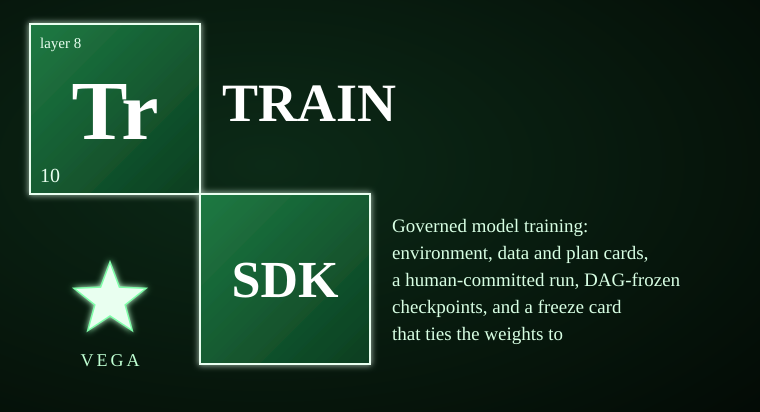

# vega-train-sdk



<!-- vega-install-order -->
> **Build order: 8/8. This kit needs 7 other Vega kits installed first.** Install them in this order, then this one:
> 1/8 `vega-custody-sdk`  
> 2/8 `vega-governance-jacket-sdk`  
> 3/8 `vega-librarian-sdk`  
> 4/8 `vega-harness-sdk`  
> 5/8 `vega-dkg-lattice-sdk`  
> 6/8 `vega-superproof-sdk`  
> 7/8 `vega-pareah-sdk`  
> 8/8 `vega-train-sdk` (this kit)
> Install each with `pip install --no-deps git+https://github.com/jasonblasiak868-code/<name>` in the order shown, plus `pip install cryptography numpy safetensors`. Full steps: [INTEGRATION_GUIDE](https://github.com/jasonblasiak868-code/vega-umbrella-sdk/blob/main/INTEGRATION_GUIDE.md).

The layer-8 ("learn") owner of the Vega SDK family: **governed model training and freeze cards**. This kit records exactly what a model learned from — which bytes, under which licence, on which machine, under which plan, with which held-out tests kept separate, what got frozen — and which human authorised the run with a single-use signature. It exists to prevent one failure: months after training, nobody can honestly answer "what did this model learn from, and who said yes?" Say it plainly: **this kit governs training; it does not ship the trainers.** GPU and large-language-model trainers are plug-ins, not included. Two small reference back ends (a deterministic numpy network and a CPU torch template using safetensors) come with the repo so the whole governed path can be exercised and replayed end to end.

> **Licensing.** Source-available, not open source. Free for personal use; free for registered small businesses (under US$1M revenue and valuation); everyone else needs a commercial license (see LICENSE; for a commercial license write to jasonblasiak.ai.mail@gmail.com). Patent pending. Draft licence text, not yet reviewed by an attorney.

Package: `vega_train` (src layout). Depends on: vega-custody-sdk, vega-governance-jacket-sdk, vega-harness-sdk, vega-pareah-sdk, vega-dkg-lattice-sdk, vega-superproof-sdk.

The family overview in one line: governed training that records exactly what a model learned from, including keeping test data separate.

## Why this exists

Training is where data becomes behaviour. Everything a model later does comes out of the bytes it learned from, yet the usual answers cannot be inspected after the fact. "We trained it to be careful" is a claim about probabilities, not a record. A policy promising clean data is a promise: nothing stops a run from quietly learning from the wrong bytes, baking a secret into weights that get shared, or letting the test set leak into training. And a training process that checks itself is the thing being checked doing the checking.

So this kit turns every run into evidence instead of claims. Before a run: an environment card (machine, packages, GPU as reported — never your other environment variables), a data card (file hashes, never content; licence class; a file holding a credential is refused), and a plan bound to both plus the PRE card that permits training. To run at all: a human's single-use commitment for exactly this plan, spent on the record. During the run: every checkpoint is written, read back, hashed, and the hash recorded before the next chunk trains; any failure halts with a reason, and a halted run resumes only under a NEW commitment, from a checkpoint that is re-hashed first. After: a freeze card ties the weights to everything that made them, and an independent verifier recomputes every claim from the files — including, for a deterministic trainer, a full replay.

On top of that runs a conduct layer for training behaviour itself: a human-signed conduct code, reward arithmetic where one serious violation erases the episode's task reward (shared across a team), template-built training examples from precedent records the owner supplies, a goal card that keeps the person's request verbatim with testable success tests, and an evaluator that measures what a model actually does on held-out probes.

## Capabilities

| Capability | How you can check it |
|---|---|
| Environment card: machine, packages, GPU as reported, allow-listed determinism settings only; fingerprint and drift | `env_card.py` — `tests/test_train.py`, `tests/redteam_2_cards_freeze_verify.py` |
| Data card: hashes never content, licence class (strictest wins), taint, credential file refused, verified load, deterministic split | `data_card.py` — `tests/redteam_2_cards_freeze_verify.py` |
| Small canonical back ends: numpy MLP (deterministic) and a CPU torch template; no pickle, canonical checkpoint bytes | `trainers.py` — `tests/test_train.py`, `tests/redteam_1_run_integrity.py` |
| Governed run: plan, single-use commitment, PRE check, hashed checkpoints, budgets, hard stop, resume under a new commitment | `run.py` — `tests/test_train.py`, `tests/redteam_1_run_integrity.py` |
| Freeze card + independent verifier with optional replay; a frozen run refuses everything | `run.py` (`freeze`, `verify_freeze`) — `tests/redteam_2_cards_freeze_verify.py` |
| Lattice-governed data selection: DKG nodes, held-out set by fixed hash rule, dedupe, licence and taint rules, ablation plans, TRAINED_ON/HELD_OUT links | `lattice_data.py` — `tests/test_lattice_data.py`, `tests/mutations_lattice.py` |
| Bundle: seal a run's cards into one superproof, open with every card re-checked | `bundle.py` — `tests/test_bundle.py` |
| Goal request bar: request kept verbatim, identity level, success tests, a model may draft but never approve | `goal.py` — `tests/test_conduct.py` |
| Signed conduct code, severity-weighted reward arithmetic (erase tier, team sharing), run-time meta-audit that fails to ESCALATE | `conduct.py` — `tests/test_conduct.py`, `tests/mutations_conduct.py` |
| Precedent-based training examples: refusals, preference pairs, allowed-behaviour examples, held-out probes; private-negative flag | `moral_data.py` — `tests/test_conduct.py` |
| Behaviour measurement on held-out probes: violation rate with 95% Wilson upper bound, over-refusal, by severity tier | `behavior_eval.py` — `tests/test_conduct.py` |
| One command line (JSON lines) for prepare / start / resume / freeze / verify / status / action | `__main__.py` — `tests/test_cli.py` |

A minute per-capability inventory — what each capability enforces, why a prompt-level policy structurally cannot, and where each honest limit sits — is in CAPABILITIES.md.

## Where it sits in the family

```
 15 assemble      vega-umbrella-sdk
      ...
>>>  8 learn      vega-train-sdk             THIS KIT <<<
  7 knowledge    vega-dkg-lattice-sdk        the lattice nodes this kit selects training data from
  6 conduct      vega-harness-sdk            record chains, commitment burn, use-gate licence classes
  3 adapt        vega-pareah-sdk             PRE / model / runtime / server cards
  2 seal         vega-superproof-sdk         the bundle seal
  1 authority    vega-governance-jacket-sdk  the human's single-use signed commitment
  0 record       vega-custody-sdk            chains, capsules, safe paths, bounded processes
```

It requires six SDKs — the most-connected SDK in the family — and every dependency points down layers only. No SDK in the public family depends on it yet; the family registry (vega-umbrella-sdk) records its place. One family, one organism: every SDK owns exactly one concern and uses the owner of every other concern instead of growing its own copy.

## Quick start

Put this repo's `src/` and the `src/` of the six dependency repos on `PYTHONPATH`, then:

```python
from vega_train import cards

demo = cards.seal({"kind": "DEMO", "note": "a card is plain JSON with a kind"})
print(demo["card_hash"][:16], cards.intact(demo, "DEMO"))   # True
demo["note"] = "edited after sealing"
print(cards.intact(demo, "DEMO"))                           # False: the hash no longer matches
```

The full path (`prepare` a spec, sign a commitment in your own terminal, `start`, `freeze`, `verify --replay`) is exercised end to end by `tests/test_cli.py`.

## What it does NOT do

- A freeze proves which bytes produced which weights under which plan, and that a human approved that plan. It does not prove the model is good, safe, or free of memorised data.
- A replay proves reproducibility only for a deterministic trainer on the same machine setup. GPU runs are not claimed reproducible.
- The trainer runs in this process with this process's rights: containment is process-level, not an operating-system sandbox.
- The licence classes, taint rules and conduct-code tiers are policy encoded as data, not legal advice. Law differs by place; have citations checked by an attorney.
- This program never signs or mints a commitment; the human does that in their own terminal.
- It does not ship GPU or large-language-model trainers, and remote/cloud training servers are designed only, not built. Plug your own Trainer in (see `TorchTrainer`). The installed torch here is CPU-only.
- Training on a conduct code changes how likely a model is to act a certain way; it gives no guarantee, and the external gates stay in force. A reward for "no violations" can teach hiding them, so violations must be detected by outside audit, not by the model's own report.
- It does not rank or score lattice nodes itself: real scores come from the caller, and an unscored node is kept, placed last and said so — never given an invented number.
- This repo is not a security review of anything, and its own automated review is shallow by design (see REVIEW.md's limits).

## Tests

STATUS.md: **118 tests in 8 files, all passing** — `test_train.py`, `test_lattice_data.py`, `test_conduct.py`, `test_cli.py`, `test_bundle.py`, plus the two red-team files `redteam_1_run_integrity.py` and `redteam_2_cards_freeze_verify.py` (`mutations_conduct.py` and `mutations_lattice.py` are mutation helpers; `support.py` is shared test scaffolding). REVIEW.md's automated run reports 67 tests ok across 4 test files plus both red-team files, with 0 high / 0 medium / 0 low findings and 1 reviewed info note.

To run: put this repo's `src/` and the dependency repos' `src/` directories on `PYTHONPATH`, then run each file in `tests/` (e.g. `python tests/test_train.py`).

## Status & honesty

This is a reference implementation and a work in progress. Status is PARTIAL: everything in the capability table above is BUILT and tested, but GPU and LLM trainers are plug-ins (not included), remote and cloud training servers are designed only, real ranking scores for the lattice curriculum come from the caller (none are invented here), and the reinforcement-learning trainer that would use the conduct reward is a plug-in too. It has not been independently security-reviewed, and no expert has reviewed the cryptography. See SECURITY.md for the threat model and STATUS.md for the canonical built-vs-designed list. Patent pending (U.S. provisional application 64/178,949 and others). This kit details one branch of a broader filed architecture. The remaining branches are the subject of filed disclosures and are outside the scope of this repository.
